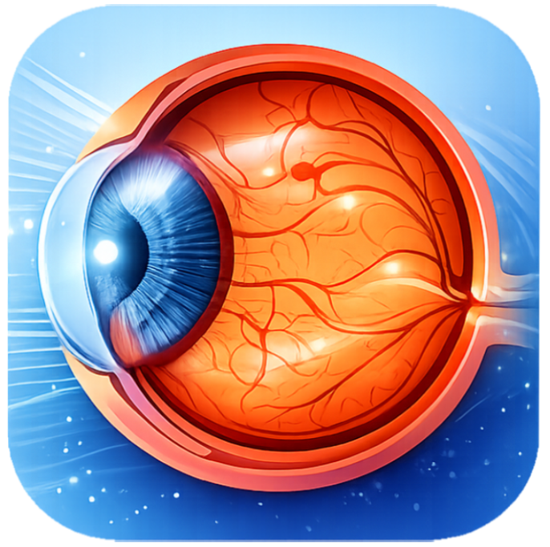

<div align="center">



# RetinopatiaApp

**Learn to see the signs. Not just the AI's answer.**

An educational desktop trainer for recognizing diabetic retinopathy  
**Fundus imaging · Interactive annotation · Explainable AI**


<p align="center">
  
  
  
  
  
</p>


**[Website](https://retinopatia-app.vercel.app)** · **[Source setup](#run-from-source)** · **[Telegram \[🇷🇺\]](https://t.me/retinopatia_app)**

</div>

---

## Overview

Most AI-based screening systems focus on delivering a prediction. **RetinopatiaApp takes an educational approach:** the learner examines a retinal fundus image, selects a disease stage, and highlights suspicious regions *before* comparing their assessment with the model's output.

Powered by **EfficientNet-B0**, **Grad-CAM**, and an interactive annotation canvas, the application helps learners explore both their stage selections and the areas that influenced a model's prediction.

> [!IMPORTANT]
> **Educational use only.** RetinopatiaApp is not intended for clinical screening, diagnosis, or treatment decisions. Grad-CAM is **not** a medically verified lesion map, and the app's scores are **not validated measures of clinical competence**.

## Training workflow

| | Stage | What happens |
|:--:|---|---|
| **01** | **Explore** | Open a randomly selected retinal fundus image |
| **02** | **Annotate** | Mark suspicious regions with a brush or eraser; choose a diabetic retinopathy stage |
| **03** | **Analyze** | EfficientNet-B0 predicts a stage and Grad-CAM generates an attention map |
| **04** | **Compare** | View your annotation alongside the model's highlighted regions; calculate Dice overlap |
| **05** | **Reflect** | Review the result and track your training history and statistics. The final training score combines **stage assessment (80%)** and **attention overlap (20%)** |

## Features

| Area | Included capabilities |
|---|---|
| **Interactive training** | Freehand annotation, brush and eraser, adjustable brush size, zoom and pan |
| **AI feedback** | Five-stage EfficientNet-B0 classification, Grad-CAM heatmaps, attention comparison |
| **Progress** | Training history, last activity, QWS and AIS indicators |
| **Accounts** | Registration, sign-in, password changes and account deletion |
| **Desktop UX** | Custom Qt 5 widgets, responsive background processing, unified visual style |

<details>
<summary><b>What do QWS and AIS mean?</b></summary>

**QWS** (Knowledge Quality Score) describes performance in stage assessment.  
**AIS** (Attention Similarity) describes the similarity between a user's marked regions and the model's Grad-CAM attention map.

Both are project-specific educational indicators, **not medical performance metrics**.

</details>

## Technology

<div align="center">


</div>

| Component | Stack |
|---|---|
| **Desktop application** | *Python 3.11*, *Qt 5* |
| **Image classification** | *PyTorch*, *timm*, *EfficientNet-B0* |
| **Explainability** | *Grad-CAM* via PyTorch forward and backward hooks |
| **Image processing** | *NumPy, OpenCV* |
| **Model formats** | *PyTorch*, *ONNX* |
| **Supporting services** | *FastAPI*, *PostgreSQL*; separate web portals built with *Next.js* and *TypeScript* |

<details>
<summary><b>Beyond the desktop app</b></summary>

The project also includes a separately maintained backend and web portals for educators and educational organizations. Some of these capabilities belong to expanded offerings and are developed in private repositories.

</details>

## Run from source

**Requirements:** Python 3.11 and project dependencies. Some functions depend on separately maintained server services, model files, and the training image dataset.

```bash
git clone https://github.com/redictor/RetinopatiaApp.git
cd RetinopatiaApp
python -m venv .venv
```

**Activate the environment:**

```powershell
# Windows / PowerShell
.venv\Scripts\Activate.ps1
```

```bash
# macOS / Linux
source .venv/bin/activate
```

**Install and launch:**

```bash
python -m pip install -r requirements.txt
python main.py
```

> [!NOTE]
> Running from source does not automatically provide access to all server-backed features. For the intended end-user installation, see the [project website](https://retinopatia-app.vercel.app).

## Roadmap

- [ ] Extended statistics and training-result export
- [ ] Support for additional training datasets
- [ ] Improved attention visualization
- [ ] Inference performance and GPU options
- [ ] Further UI/UX and stability improvements

These are **planned improvements**, not currently released features!

## FAQ

<details>
<summary><b>Can RetinopatiaApp be used to diagnose patients?</b></summary>

No. It is an educational application, not a diagnostic device or replacement for qualified clinical judgement

</details>

<details>
<summary><b>Does Grad-CAM show precisely where the lesions are?</b></summary>

No. It **highlights** image regions that influenced the model's prediction. These regions do not necessarily correspond to clinically confirmed pathological changes

</details>

<details>
<summary><b>What does the Dice score measure?</b></summary>

It measures overlap between a user's binary annotation and a thresholded version of the model's attention map. It is **not** a comparison against a clinician's ground-truth annotation

</details>

## License

This source repository is distributed under the **RetinopatiaApp Non-Commercial License**. See the [LICENSE](LICENSE) file for permitted uses and restrictions.

> [!CAUTION]
> Dependencies retain their own licenses. The repository's custom license does not replace third-party license obligations.

## Feedback

Ideas, reproducible bug reports, and technical feedback are welcome via [GitHub Issues](https://github.com/redictor/RetinopatiaApp/issues). Updates are also shared on [Telegram](https://t.me/retinopatia_app)
P.s. The channel is conducted in Russian

---

<div align="center">

**[Website](https://retinopatia-app.vercel.app)** · **[GitHub](https://github.com/redictor/RetinopatiaApp)** · **[Telegram \[🇷🇺\]](https://t.me/retinopatia_app)**

<sub>© 2026 · Created by <a href="https://github.com/redictor">redictor</a></sub>

</div>
